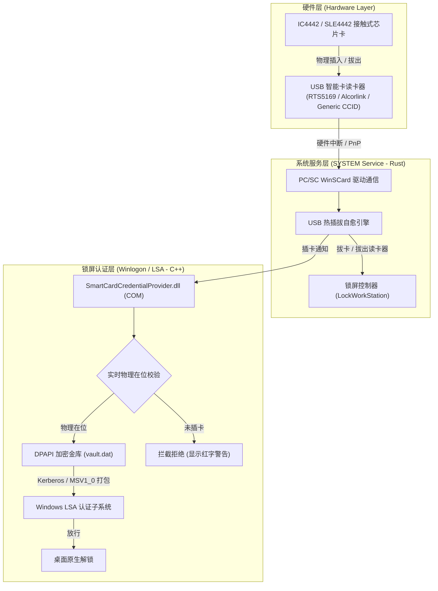

# Windows SmartCard Auto Unlock (RTS5169 / IC4442)

<p align="center">
  
  
  
  
  
</p>

基于 **Realtek RTS5169 / Alcorlink 等通用 EMV/CCID 智能卡读卡器** 与 **IC4442 (SLE4442) 接触式存储芯片卡** 的 Windows 硬件级插卡自动解锁与拔卡原生安全锁屏系统。

彻底告别旧式的 GUI 界面与不可靠的锁屏按键模拟注入（`SendInput`），采用微软官方推荐的 **系统级 Windows 原生凭据提供程序（Credential Provider COM DLL）** 与 **轻量级 Rust 后台守护服务**。

---

## 🌟 核心特性

- ⚡ **毫秒级物理拔卡锁屏**：拔出 IC4442 卡片瞬间，后台服务在 100ms 内触发 Windows 原生 `LockWorkStation` 锁屏。
- 🔓 **Windows 原生安全凭据认证**：自制 COM 凭据提供程序（CLSID: `{7C3B984A-94B6-4E87-8A33-8FE58D6E9A42}`），插入卡片瞬间由 Windows Winlogon / LSA 认证子系统直接完成安全认证，零界面卡顿、零假死、不受 UAC 隔离限制。
- 🛡️ **三重硬件物理在位防线（防绕过）**：
  - **界面隐藏**：未插入物理卡片时，锁屏 Tile 上的确认箭头（Submit Button）彻底隐藏；
  - **凭据拒发**：若检测到卡片未就绪，强制返回 `CPGSR_NO_CREDENTIAL_FINISHED`，绝不提供凭据；
  - **实时芯片状态校验**：通过 WinSCard PC/SC 底层寄存器实时核验 `SCARD_STATE_PRESENT`，防止任何内存伪造或状态竞态。
- 🔌 **USB 读卡器热插拔自适应重连**：拔出 USB 读卡器时立即安全锁屏并自动释放陈旧上下文，重新插入 USB 时 0.5 秒内自愈并重新建立 PC/SC 通信，无惧断连。
- 🔒 **硬件级 DPAPI 安全加密**：解锁凭据采用 Windows 原生数据保护接口（`CryptProtectData`）机器级加密存储于系统保护目录，杜绝明文风险。
- 🚀 **极低资源消耗**：Rust 原生服务常驻内存仅 **~2 MB**，CPU 占用率 **0.0%**。

---

## 🏗️ 系统架构图



---

## 🧰 支持的硬件规格

| 组件 | 规格要求 | 测试通过型号 |
| :--- | :--- | :--- |
| **智能卡读卡器** | USB 通用 CCID / PC/SC 兼容读卡器 | Realtek RTS5169、Alcorlink USB Smart Card Reader、Generic EMV Reader |
| **芯片卡** | 接触式存储卡 (Contact Memory Card) | SLE4442 / IC4442、SLE5542 |
| **操作系统** | Windows 10 (1809+) / Windows 11 (21H2+) | Windows 10 x64, Windows 11 22H2/23H2/24H2 |

---

## 🚀 快速上手

所有系统功能均已统一集成至原生 CLI 主程序 `bin\smartcard_unlock.exe`。

### 1. 配置 Windows 解锁密码
在终端运行：
```powershell
.\bin\smartcard_unlock.exe set-pin
```
根据提示输入当前账户的 Windows 登录密码并回车。凭据将通过 Windows DPAPI 安全加密并存储到操作系统保护金库中。
> 亦可通过直接传参设置：`.\bin\smartcard_unlock.exe set-pin "您的密码"`

### 2. 一键安装并启动系统服务
以管理员身份打开终端运行：
```powershell
.\bin\smartcard_unlock.exe install-service
```
程序将自动：
1. 注册并部署 `SmartCardCredentialProvider.dll` 至系统凭据提供程序注册表；
2. 安装并启动 `SmartCardUnlock` Windows 后台自启服务。

### 3. 查看系统与硬件运行状态
```powershell
.\bin\smartcard_unlock.exe status
```

### 4. 验证功能
- **测试锁屏**：拔出 IC4442 芯片卡，系统在 0.1 秒内立即锁定屏幕；
- **测试解锁**：将卡片插入读卡器，系统将在 0.1 秒内自动验证身份并原生进入桌面；
- **测试热插拔**：拔下读卡器 USB，系统立即锁定；重新插上读卡器，服务自动重连就绪。

---

## 🛠️ 项目目录说明

```text
.
├── bin/                               # 预编译原生组件
│   ├── SmartCardCredentialProvider.dll # Windows 原生凭据提供程序 COM DLL
│   └── smartcard_unlock.exe           # 系统服务与管理主程序 (CLI / TUI)
├── credential_provider/               # C++ 原生凭据提供程序源码 (MinGW-w64)
│   ├── CClassFactory.cpp / .h         # COM 类工厂
│   ├── CSmartCardProvider.cpp / .h    # 凭据提供程序生命周期与监听
│   ├── CSmartCardCredential.cpp / .h  # 凭据磁贴、硬件防线校验与序列化打包
│   ├── common.h                       # DPAPI 与 WinSCard 状态探针
│   ├── dllmain.cpp                    # COM DLL 注册与导出
│   └── SmartCardCredentialProvider.def
├── rust-core/                         # Rust 核心系统服务源码 (Cargo)
│   ├── src/
│   │   ├── main.rs                    # 命令行管理与前台运行模式
│   │   ├── service.rs                 # Windows NT Service (SYSTEM)
│   │   ├── scard.rs                   # PC/SC WinSCard 通信与重连自愈
│   │   ├── lock.rs                    # 会话检测与原生锁屏
│   │   └── vault.rs                   # DPAPI 保险库读写
│   └── Cargo.toml
├── tools/                             # 硬件诊断工具
│   └── rts_4442_tool.py               # IC4442 底层寄存器直读诊断脚本
├── build.bat                          # 统一工程自动化编译脚本 (C++ + Rust)
├── LICENSE                            # MIT 开源许可证
└── README.md                          # 项目使用与架构说明
```

---

## 🔨 从源码构建

### 环境要求
- **Rust** 1.75+（使用 MSVC 或 GNU 工具链均可）
- **MinGW-w64**（包含 `g++` 且已加入 PATH，用于编译 C++ COM DLL）

### 一键构建
直接运行项目根目录下的自动化构建脚本：
```cmd
build.bat
```
脚本将全自动检测 MinGW 与 Cargo 工具链，完成 `SmartCardCredentialProvider.dll` 与 `smartcard_unlock.exe` 的构建并输出到 `bin/` 目录。

---

## ⚠️ 免责声明 (Disclaimer)

本项目仅用于个人学习交流、实验室环境及合法的本地物理安全加固。使用者需自行承担因不当配置导致的系统登录锁定等风险。请妥善保管好您的 Windows 本地/微软账户主密码。

---

## 📄 开源许可证

本项目基于 [MIT License](LICENSE) 开源发布。
